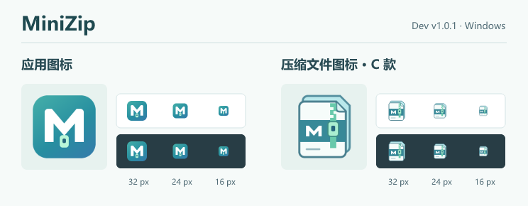

# MiniZip

**Dev v1.0.2** · Windows x64 本地压缩包与文件管理应用。

[GitHub 项目](https://github.com/SakuraEdge/MiniZip) · [下载与更新说明](https://github.com/SakuraEdge/MiniZip/releases) · [构建状态](https://github.com/SakuraEdge/MiniZip/actions)

工作台和快速压缩小窗采用薄荷绿与浅蓝配色。应用保留 M 形拉链图标，关联的压缩文件使用独立的 C 款叠页图标。侧栏默认收起；双击压缩包即可浏览内容，没有示例数据或广告。



## 运行

[下载 Windows x64 安装包](https://github.com/SakuraEdge/MiniZip/releases/download/dev-v1.0.2/MiniZip-Dev-1.0.2-Setup-x64.exe)，或在旧版侧栏进入「软件更新」，开启「接收 Dev 开发版本」后检查更新。

安装向导可选择注册常用压缩包格式、添加右键菜单、打开 Windows 默认应用设置。要在资源管理器里看到叠页图标，请将相应文件类型的默认应用设为 MiniZip。不会改动受保护的 UserChoice；Windows 11 的传统右键项可能位于“显示更多选项”。

本地构建后也可运行 `release/MiniZip-Dev-1.0.2/MiniZip-win32-x64/MiniZip.exe`，请保留整个目录。

安装后无需 Node.js、7-Zip 或 LZ4。文件处理完全本地执行；只有软件更新会请求 GitHub。Dev v1.0.2 的应用和安装包未做 Authenticode 签名，Windows 可能显示“未知发布者”。发布页提供 SHA-256 校验文件；该校验不等同于发布者签名。

开发运行：

```powershell
npm install
node node_modules/electron/install.js
npm run setup:engine
npm run icons
npm start
```

`index.html` 可在浏览器中查看界面和读取选择的本地文件夹；压缩包操作及系统集成需要桌面版。

## 当前功能

Dev v1.0.2 新增包内程序临时运行与退出后回写、内存预览、拖动框选和右键文件操作。[查看本版更新说明](releases/dev-v1.0.2.md)。

- 主工具栏直接展示“解压到当前目录”“解压到…”与“删除所选”，无底部口号。
- 原生文件 / 文件夹选择器，支持多选、拖入、通过命令行参数打开文件；每个压缩包使用独立工作台窗口。
- 侧栏默认仅图标，展开后显示文字；不提供示例包、示例收藏和虚拟任务。
- 资源管理器菜单统一收纳在 MiniZip 子菜单。压缩包显示打开和三种解压入口，所有文件和文件夹均可再次压缩。
- 右键“添加到压缩文件…”仅打开快速压缩小窗；ZIP / 7Z 快捷项预选格式和级别，确认后执行，不打开主工作台。
- 创建 ZIP / 7Z，支持压缩级别、中文密码、原文件保留、进度与取消；输出校验通过后才提交。
- 列表和网格均可按住鼠标左键拖动框选，支持边缘滚动、Ctrl 追加、Esc 撤销本次框选。右键已选项目保留整组选区；右键未选项目只操作该项。
- 包内右键提供打开、用外部应用打开、解压所选、重命名和删除。未加密 ZIP / 7Z / TAR 支持文件及目录重命名（也可按 F2）；同目录冲突拒绝覆盖，修改在副本校验通过后提交并保留原包备份。只读项目不能被改名或删除。
- “解压到当前目录”默认自动重命名冲突文件；“解压到…”可选择重命名、跳过或覆盖，覆盖有额外确认。
- 流式调用 7-Zip 26.06、LZ4 1.10.0；UTF-8 中文密码 ZIP 使用 zip.js 兼容回退。
- 密码不写入配置、日志或命令行参数；仅当前归档会话保留，关闭归档或应用后清除。
- 文件完整性测试、真实任务结果、可取消解压。安全提交阶段不可取消。
- 未加密 ZIP / 7Z / TAR 支持删除包内文件。先修改副本并校验剩余内容，成功后在同目录保留 `.minizip-backup-*` 原包备份。
- 本地文件夹的删除操作移至系统回收站，需要明确确认。
- 包内双击文本、常见位图或 PDF，默认从解码流读取到限长内存预览，不解压到工作目录，关闭即释放预览内容。不支持或过大的文件可选择用外部应用打开或解压到指定位置。本地文件夹里的文件仍用原路径直接打开。
- 普通文档用外部应用打开时只取出所选文件，重复打开复用副本。双击包内 EXE 则在确认来源、临时范围与大小后，临时展开程序所在目录及子目录，保留相对路径、配置、DLL 和资源；根目录的 EXE 需要临时展开整个包。程序以当前用户权限运行，临时目录不是安全沙箱。
- 包内程序退出后检查普通文件的实际内容。无变化自动清理；有新增、修改或删除时列出明细，选择“更新压缩包”会校验写回、保留原包备份并清理，选择“不更新”只清理本次运行目录。失败、被占用或数据再次变化时保留尚未处理的数据，不强制删除。
- 双击嵌套压缩包打开独立工作台；内层保存后，外层提示是否写回。
- 监测外部编辑并显示待保存提示。ZIP / 7Z / TAR 可写回，含中文密码 AES ZIP、ZipCrypto ZIP 和加密 7Z；先校验副本，提交时保留原包备份。
- RAR 等只读格式提供另存修改副本，不改写原包。
- 软件更新页展示 GitHub Releases 版本与更新内容；支持自动检查、Dev/Rev 筛选、下载和 SHA-256 校验，再经用户确认启动安装。

## 更新通道

- 开发版：当前显示 `Dev v1.0.2`，Git 标签 `dev-v1.0.2`，GitHub Release 标记为 prerelease。
- 正式版：显示 `Rev v1.0.0`，Git 标签 `rev-v1.0.0`，Release 不标记 prerelease。
- 使用数字版本比较；相同数字版本的 Rev 高于 Dev。
- 关闭“接收 Dev 开发版本”后，只检查 Rev。更新源固定为 `release-config.json` 中的公开仓库。
- 下载只接受本项目匹配版本的 HTTPS GitHub Release 资源，并要求 SHA-256 校验；不执行更新说明内的 HTML 或脚本。
- 安装新版本始终需要用户点击确认，没有静默替换程序或自动重启。

## 格式与测试

| 格式或场景 | 当前状态 |
| --- | --- |
| ZIP / 7Z / TAR | 已实测列表、解压、完整性校验与删除备份 |
| ZIP / 7Z 创建 | 已实测正常及中文密码、文件夹、空目录和输入保护 |
| 外部编辑与写回 | 已实测未加密 ZIP / 7Z / TAR 和中文密码 ZIP / 7Z，原包备份与嵌套包修改 |
| RAR5 | 已使用 libarchive 独立测试样本验证列表与解压；只读 |
| RAR / RAR5 加密与分卷 | 由 7-Zip 提供能力；尚未对所有版本、密码编码和分卷变体完成测试 |
| LZ4 | 已实测原生帧解码与跨系统语言 Unicode 路径，按单文件流处理 |
| GZ / BZ2 / XZ / ZSTD | 已实测单文件流解码 |
| TAR.GZ / TAR.LZ4 | 已实测两层目录解析与解压 |
| 中文密码 7Z | 已实测加密文件头、错误密码和解压 |
| 中文密码 AES ZIP / ZipCrypto | 已实测 UTF-8 密码兼容解码 |
| CAB / ISO / ARJ / LZH / LZMA 等 | 内核可识别，尚未逐一做完整的应用级测试 |

不承诺“所有压缩格式”或未经基准测试的性能数字。后续仍需扩展大型归档、历史密码编码、分卷缺失和损坏文件的样本覆盖。

## 安全边界

- 界面进程启用沙箱、上下文隔离与 CSP，无 Node.js 或任意文件访问权限。
- 通过受限 IPC 操作已打开的归档；解压目的地只接受系统选择器授权目录或当前压缩包目录。
- 拦截绝对路径、路径越界、NTFS 数据流、符号链接 / 硬链接、Windows 非法文件名及大小写冲突。
- 解压先写入目标盘的随机临时目录，检查完成后提交。出错时尝试回滚；无法回滚会保留恢复目录并提示路径。
- 原压缩包被外部程序修改后，拒绝继续使用过期会话。
- 当前安全上限：每个压缩包 100,000 个条目、128 GiB 解压结果；本地文件夹 50,000 个条目、32 层。
- 文本预览上限 1 MiB，常见位图 12 MiB，PDF 24 MiB，同时检查实际输出字节数；HTML / 脚本作为纯文本显示，不执行。包含链接的归档整体拒绝处理。
- 文件任务支持取消，不支持暂停恢复；安全提交阶段不可取消。
- 同目录写入任务串行，不允许并发重叠目录写入。压缩包目录扫描与密码验证目前不提供取消按钮。
- TAR 压缩容器解析使用临时缓存，大文件首次打开可能需要等待；缓存会在关闭归档 / 应用时清理。
- LZ4 使用文件句柄读取中文及 Unicode 路径，首次打开会执行完整性校验，大文件需要等待。
- 7Z 的多输入压缩当前要求各输入位于同一父目录，跨目录可使用 ZIP。Explorer 连续多选命令会短暂合并，极慢机器也可能分为多个小窗。
- **外部编辑与空间**：需要真实路径的应用使用 `%TEMP%/MiniZip-edits/opened-*`。Windows 返回的进程可确认为所选程序或文档持有者时，MiniZip 在其退出后检查副本。复用已有进程、标签页单独关闭等情况没有可靠的文档关闭通知；请先关闭外部文件，再在工作台点“结束外部编辑”。不把启动成功、窗口失焦或短暂解锁当作关闭。
- 未修改的副本在编辑结束后清理；改过的先提示，选“保存到压缩包”会校验写回并保留原包备份，选“不更新”并确认则保持原包不变。编辑已结束的文件随决定清理；在编辑期间提前写回，副本要等真正结束才清理。删除前独占打开同一文件并校验 SHA-256，修改、占用或不明文件不强删。不清理旧版 `work-files`，也不扫描删除崩溃遗留文件；未处理的副本可从“外部工作副本”找回。
- 独立打开内层压缩包需要能随机访问的归档文件，使用受管理的临时副本；关闭内层后由外层处理修改。`.tar.gz` 等复合容器另需临时 TAR，关闭时清理。显式解压的输出和保存后保留的原包备份不属于预览缓存。
- 加密归档交给外部应用时必须解密出本机副本，首次打开会提示；密码仍不保存到磁盘。
- EXE 运行目录位于 `%TEMP%/MiniZip-runs/run-*`。Windows 可确认时，会等待程序及其普通子进程退出；若通过系统代理启动而无法确认，需在所有相关程序退出后点击“已退出程序”。不会监控注册表、AppData 或其他目录。一次临时运行最多 8,192 项、2 GiB；依赖包内其他位置或超出限制的程序请手动解压。只读包可以打开运行目录另存文件，不能写回原包。崩溃、强制关机等情况下不保证清理，以保留数据为先。
- 普通文档的外部编辑只跟踪已打开的成员；其编辑器另存的新文件不自动加入原包。
- Windows 11 原生首层菜单需要受信任签名和应用身份；当前开发版使用兼容聚合子菜单，可能位于“显示更多选项”。

## 验证与打包

```powershell
npm run check
npm test
npm run test:ui
npm run test:desktop
npm run build
npm run installer
```

测试在项目的 `.test-work/` 下生成临时数据，结束后按已验证路径清理。不会修改用户归档。

`tests/program-runs.test.cjs` 使用本机编译的计数器 EXE 实测保存、放弃、无变化、子进程及冲突；桌面测试也从工作台双击同一程序并核对落盘结果。`node tests/portable-fixture.cjs` 可单独生成用于手动验收的 ZIP，不包含在应用中。

Playwright 浏览器测试默认使用 Windows 系统 Chrome。桌面测试使用 Electron 的测试运行环境，核验真实磁盘输出与备份内容。

也可运行 `npx playwright install chromium`，再设置 `MINIZIP_USE_BUNDLED_BROWSER=1` 使用项目测试浏览器。

安装/卸载测试会在 `.test-work/installer/MiniZip` 中安装，注册当前用户的 MiniZip 项目后卸载，并验证不改变 Windows 默认 ZIP 打开方式。检测到已有 MiniZip 安装时自动停止：

```powershell
.\scripts\test-installer.ps1 -Installer .\release\MiniZip-Dev-1.0.2\MiniZip-Dev-1.0.2-Setup-x64.exe
```

## 发布

公开仓库只保存源码，不提交原生二进制、安装包、依赖、缓存或本地测试输出。首次配置：

```powershell
node scripts/configure-release.cjs OWNER/MiniZip dev-v1.0.0
npm install --package-lock-only
```

提交匹配的发布说明到 `releases/dev-v1.0.0.md`。推送 `dev-v*` / `rev-v*` 标签后，GitHub Actions 验证、构建并发布 Windows 安装包和 `.sha256` 文件。

本地首次发布可使用 GitHub CLI：

```powershell
gh repo create MiniZip --public --source . --remote origin --push
git tag dev-v1.0.0
git push origin dev-v1.0.0
```

仓库创建需要已登录 GitHub CLI。不要将密码、令牌或 `.env` 提交至项目。

## 源码

- `index.html` / `styles.css` / `app.js` / `file-gestures.js`：前端界面、框选与右键操作。
- `desktop/main.cjs` / `desktop/preload.cjs`：桌面主进程、原生对话框与受限 IPC。
- `desktop/archive-engine.cjs`：内核调用、路径检查、暂存解压与安全删除。
- `desktop/edit-sessions.cjs`：外部工作副本、修改监测、写回及导出。
- `desktop/external-file.cjs` / `native/ExternalFile.cs`：Windows 默认应用启动、进程持有者确认及独占校验清理。开发启动、测试和打包自动使用系统 .NET Framework 4.x 编译该小工具；成品已包含，不需要用户安装编译工具。
- `desktop/zip-compat.cjs`：加密 ZIP 的流式兼容处理。
- `desktop/compress-engine.cjs`：安全压缩、输入校验和冲突保护。
- `desktop/updates.cjs`：GitHub 版本筛选、下载校验与更新设置。
- `quick.html` / `quick.css` / `quick.js`：独立快速压缩窗口。
- `core.js`：共享文件与目录工具。
- `installer/integration.nsh`：可选文件关联、右键菜单和卸载清理。
- `engines/`：原生工具及许可证。
- `scripts/`：校验下载、发布打包与测试样本处理。
- `tests/`：单元、内核和端到端测试。

## 资源与许可证

见 `THIRD_PARTY_NOTICES.md`。原生工具来自对应官方发行版，安装包 SHA-256 固定在 `scripts/setup-engine.cjs`。

用户界面与发布包不包含示例照片或示例压缩包。应用图标源文件是 `assets/favicon.svg`，叠页文件图标源文件是 `assets/archive.svg`。`npm run icons` 从两个源文件分别生成 16、20、24、32、48、64、128、256 px 的 ICO 图层；`node scripts/preview-release-icons.cjs` 直接使用这些图层生成上方对照图。
